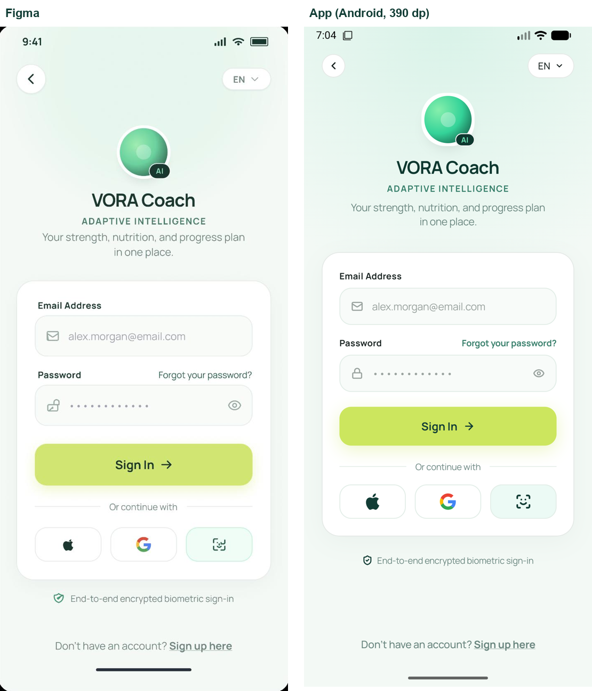
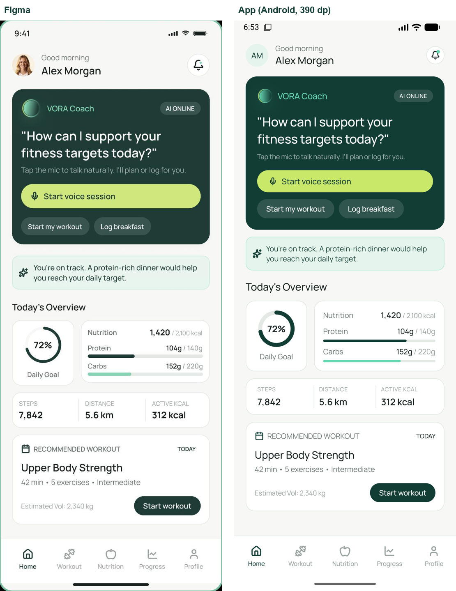
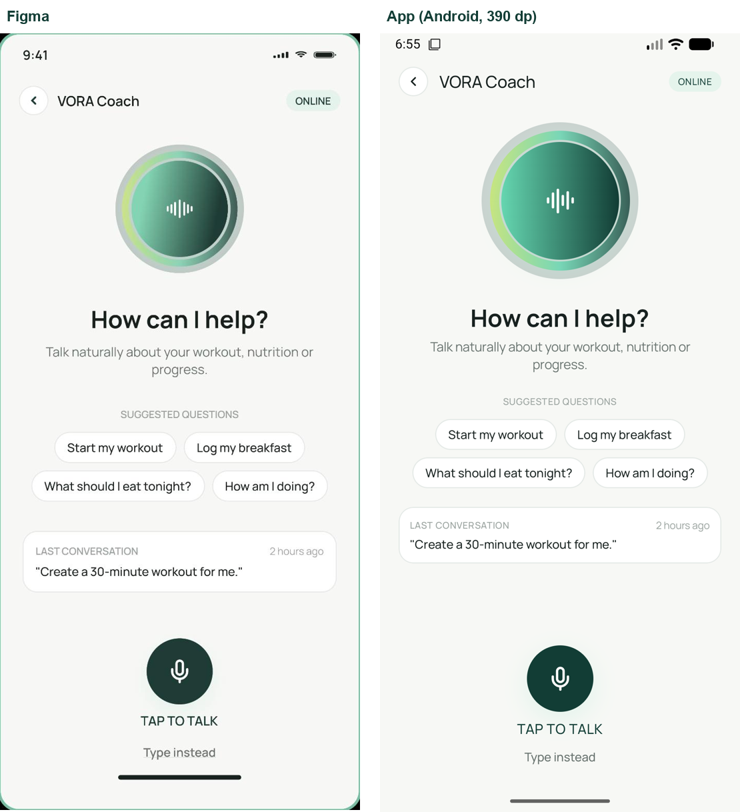
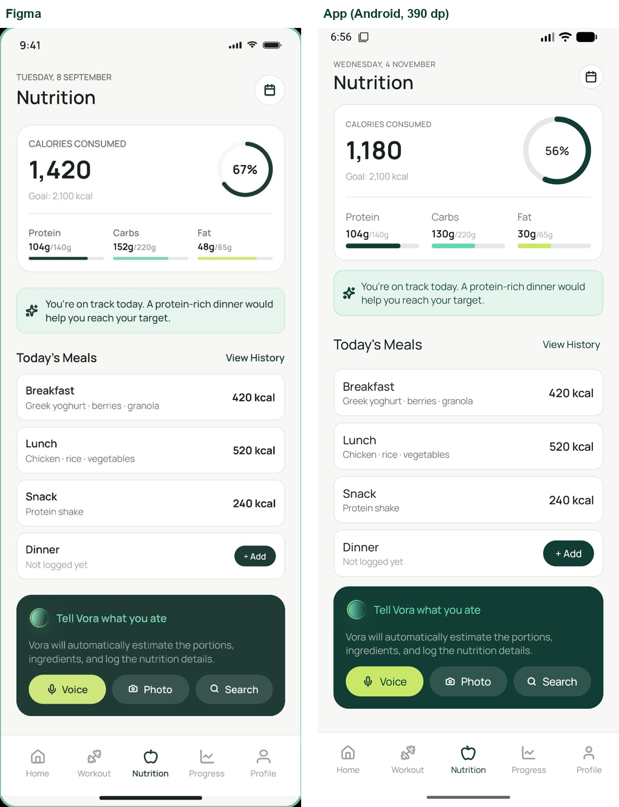
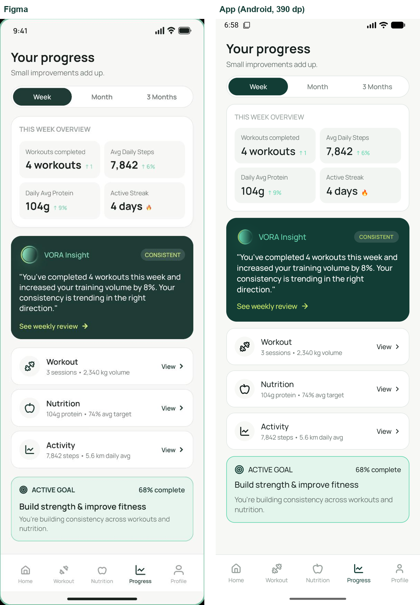

# VORA Coach

App Android (Kotlin + Jetpack Compose) de coaching de entrenamiento y nutrición, construida a partir del diseño de Figma para el parcial domiciliario de **Taller de Programación 3 / Desarrollo de Aplicaciones Móviles** (ORT Argentina, Prof. Martín Rivas, curso BE-TP3A y B).

## Integrantes

| Integrante | Área principal |
|---|---|
| María Fernanda Caballero | Navegación, inventario, README e integración |
| Alén Carbajal | Tema y componentes reutilizables |
| Joaquín Liendro | Entrenamiento (Retrofit + Room) |
| Enrique Wainstein | Nutrición (Room) |
| Lisandro Dinamarca | Asistente VORA, Progreso, Perfil y verificación visual |

## Enlaces

- **Figma:** https://www.figma.com/design/1nvbbfYNYmKAevuaG28J85/Parcial-Domiciliario-7-Oct-26
- **Servidor de la API:** https://tp3.martinrivas.ar/ (también se puede usar el servidor local del profe, ver [Probar con el servidor local](#probar-con-el-servidor-local))
- **Video de demostración:** [PENDIENTE]
- **Tag de entrega:** `entrega-tp3` [PENDIENTE]

## Estado del proyecto

Última actualización: 04/11/2026. Estados: ✅ hecho y probado · 🔶 en curso · ⬜ pendiente.

| Requisito | Estado | Detalle |
| --- | --- | --- |
| Proyecto compila, Hilt configurado | ✅ | `@HiltAndroidApp`, `@AndroidEntryPoint` |
| Navegación entre áreas (NAV02–NAV04) | ✅ | Todas las pantallas del inventario están conectadas; ya no quedan pantallas temporales |
| Tema y componentes (UI01/UI02) | ✅ | Tema en `ui/theme` y componentes en `ui/components`; 5 comparaciones con Figma más abajo |
| Retrofit: `GET /v1/workouts` y `/v1/workouts/{id}` (RF01) | ✅ | `ApiService` + `WorkoutRepository`; cada tarjeta abre su propio detalle |
| Room: caché de entrenamientos (RF02) | ✅ | Tablas `workouts` y `exercises`. Un detalle ya visto se ve con el servidor apagado, y actualizar la lista no borra los ejercicios cacheados. Detalle nunca descargado: "No disponible sin conexión." |
| Room: comidas con validación, listado por fecha, borrado con confirmación, total diario (RF03/RF04) | ✅ | Registro manual validado, lista por día, detalle, borrado con confirmación y total diario. En el flujo demo, "Add to Lunch" también guarda en Room |
| Estados de carga / vacío / error con reintento (RF05) | ✅ | Probados con los escenarios del mock (ver más abajo). Un fallo de red no borra la caché |
| Separación DTO / Model / Entity + Repository (RF06) | ✅ | `data/remote/dto`, `domain/model`, `data/local/entity` con mappers; la UI solo ve `Model` |
| ViewModel con StateFlow y corrutinas (RF07) | ✅ | `WorkoutViewModel` y `NutritionViewModel`; la rotación conserva el estado y lo escrito en el formulario |
| Hilt para repositorios y ViewModels (RF08) | ✅ | `@HiltViewModel`, repositorios por constructor, `NetworkModule` y `DatabaseModule` |
| Tests unitarios | ✅ | 24 tests en `app/src/test` (validación de comidas, total diario, fechas, tipos) |
| Video, tag de entrega, declaración de IA | ⬜ | Ver los apartados correspondientes más abajo |

## Inventario de pantallas

37 pantallas en 7 flujos, más una pantalla adicional de registro manual de comidas que no está en Figma pero es necesaria para RF03. El detalle completo (nombre en Figma, ruta, destinos y estado funcional o demo) está en [`specs/02-screens.md`](specs/02-screens.md).

| Flujo | Pantallas |
|---|---|
| Acceso | 2 |
| Inicio | 2 |
| Asistente VORA | 6 |
| Entrenamiento | 7 |
| Nutrición | 8 (+1 adicional) |
| Progreso | 6 |
| Perfil | 6 |

Pantallas **funcionales** (datos reales): lista y detalle de entrenamientos (Retrofit + Room) y comidas de Nutrición (Room). El resto son pantallas de **demostración** con datos de ejemplo, como indica la consigna.

Del flujo de Nutrición, Add Food, Voice Logging, Analyzing, Analyse Meal y Review Meal son demo (sin micrófono, cámara ni IA reales). "Search Database" muestra el aviso de modo demostración porque no tiene pantalla en Figma.

## Arquitectura

```
UI (Compose) → ViewModel (StateFlow + corrutinas) → Repository → Retrofit (DTO)
                                                              → Room (Entity)
DTO → Model ← Entity   (mappers; la UI solo usa Model)
```

- La UI no accede a Retrofit ni a los DAO: solo a través del ViewModel y el Repository.
- Hilt provee Retrofit, la base de datos Room, los DAO, los repositorios y los ViewModels.
- Estados de pantalla: `Loading`, `Success`, `Empty`, `Error` (con reintento). Un error de red no borra la caché.

## Librerías utilizadas

Las versiones están centralizadas en [`gradle/libs.versions.toml`](gradle/libs.versions.toml).

| Librería | Versión | Para qué se usa |
|---|---|---|
| Kotlin | 2.2.10 | Lenguaje de la app |
| Android Gradle Plugin | 9.3.3 | Compilación (Gradle 9.5.0 con el wrapper del repo) |
| Jetpack Compose (BOM) | 2026.02.01 | UI declarativa: `ui`, `ui-graphics`, `ui-tooling-preview` y Material 3 |
| Activity Compose | 1.13.0 | `MainActivity` con contenido Compose |
| Lifecycle (runtime, ViewModel y runtime-compose) | 2.11.0 | ViewModels y `collectAsStateWithLifecycle` para leer los `StateFlow` |
| Navigation Compose | 2.9.0 | Navegación entre las 38 pantallas y barra inferior |
| Hilt (Dagger) | 2.60.1 | Inyección de dependencias de repositorios, DAO, Retrofit y ViewModels |
| Hilt Navigation Compose | 1.3.0 | `hiltViewModel()` dentro de cada destino de navegación |
| KSP | 2.3.12 | Procesador de anotaciones para Hilt y Room |
| Room (runtime, ktx y compiler) | 2.8.5 | Base local `vora_coach_database`: caché de entrenamientos y registro de comidas |
| Retrofit + Gson converter | 3.0.0 | Consumo de la API de entrenamientos (`GET /v1/workouts` y `/v1/workouts/{id}`) |
| AndroidX Core KTX | 1.19.0 | Extensiones de Kotlin para Android |
| JUnit | 4.13.2 | Tests unitarios (`app/src/test`) |
| AndroidX Test, Espresso y Compose UI Test | 1.3.0 / 3.7.0 / BOM | Dependencias de tests instrumentados (plantilla del proyecto) |

La tipografía Manrope está embebida en `res/font` (SIL Open Font License 1.1); no se descarga en tiempo de ejecución.

## Cómo ejecutar

### Requisitos

- Android Studio 2026.2 o posterior, con el JDK que trae incluido. Desde la terminal, el wrapper (Gradle 9.5.0) corre el daemon con Java 25 (`gradle/gradle-daemon-jvm.properties`): si no está instalado, lo descarga solo la primera vez.
- Android SDK Platform 37 (`compileSdk` y `targetSdk` 37). La app corre desde Android 7.0 (`minSdk` 24).
- Un emulador o un teléfono con conexión a internet. Se probó con el dispositivo "Medium Phone" del emulador, API 37.

### Desde Android Studio

1. Clonar el repositorio y abrirlo en Android Studio.
2. Esperar la sincronización de Gradle.
3. Ejecutar la configuración `app` en un emulador o dispositivo.
4. En Sign In tocar **Sign In**: el acceso es de demostración y no pide credenciales.

### Desde la terminal

```bash
./gradlew installDebug        # compila e instala en el emulador o dispositivo conectado
./gradlew testDebugUnitTest   # corre los tests unitarios
./gradlew lintDebug           # análisis estático (reporte en app/build/reports)
```

Si `./gradlew` da "permission denied", ejecutar `chmod +x gradlew` o usar `sh gradlew`.

La app usa por defecto `https://tp3.martinrivas.ar/`. Para usar el servidor local, ver la sección siguiente.

## Probar con el servidor local

El servidor del profe (`mock/server.py`, solo biblioteca estándar de Python; viene en el material de la cátedra y no está en este repositorio) permite probar la app sin depender del servidor publicado.

1. Levantarlo: `python server.py --host 0.0.0.0` (desde la carpeta `mock`).
2. Con el emulador abierto: `adb reverse tcp:8000 tcp:8000`.
3. En `ApiConfig.kt` poner `USE_LOCAL_SERVER = true` (no commitear; para entregar tiene que quedar en `false`). El HTTP sin cifrar solo está permitido en el build de debug (`app/src/debug/AndroidManifest.xml`).

### Escenarios del mock (T60)

`MockConfig` (en `MockHeadersInterceptor.kt`) envía los headers `X-Mock-Scenario` y `X-Mock-Delay-Ms`. Con los valores por defecto (`"normal"` y `0`) no agrega ningún header.

| Escenario | Resultado esperado en la app |
| --- | --- |
| `empty` | Pantalla de lista vacía |
| `error` (503) | Mensaje de error del servidor con botón **Reintentar**; la lista cacheada sigue visible |
| `malformed` | "El servidor devolvió datos que la app no pudo leer", sin cerrarse |
| `delayMs = 3000` | Indicador de carga mientras espera |
| Servidor apagado | Detalle ya visto: se ve desde Room. Detalle nunca descargado: "No disponible sin conexión." |

El servidor publicado devolvió error 522 (Cloudflare) el 01/11/2026; la caché de Room permite seguir viendo los entrenamientos ya abiertos.

## Consideraciones

- **Pantallas funcionales y de demostración.** Solo Workouts, Workout Overview y las pantallas de comidas de Nutrition (dashboard, Today's Meals, detalle, registro manual y Review Meal) usan datos reales. El resto muestra los datos de ejemplo de Figma, como pide la consigna.
- **Acceso de demostración.** Sign In y Sign Up no validan credenciales ni crean cuentas; Log out (en Settings) vuelve a Sign In.
- **Funciones simuladas.** No se usan el micrófono, la cámara ni un modelo de IA reales. Las acciones sin pantalla en Figma (por ejemplo "Search Database" o el selector de idioma del login) muestran un aviso de modo demostración. El único permiso que pide la app es `INTERNET`.
- **Dependencia del servidor.** Los entrenamientos vienen de la API. Si el servidor no responde, la lista muestra el error con **Reintentar** y lo que ya esté en caché; un detalle nunca abierto muestra "No disponible sin conexión.".
- **Datos locales.** Las comidas se guardan solo en el dispositivo, en Room. Desinstalar la app o borrar sus datos las elimina, y no se sincronizan entre dispositivos.
- **Idioma.** Los textos están en inglés, como en Figma (`values/strings.xml`), con traducción al español (`values-es/strings.xml`). La app toma el idioma del sistema.
- **Tema.** Figma define solo tema claro, así que la app no tiene modo oscuro.
- **Tamaño de los controles.** Los botones y chips miden lo que indica Figma: se desactivó el área táctil mínima de 48 dp de Material para no agregar espacio que no está en el diseño (ver `specs/06-design-tokens.md`).
- **Emulador.** Si muestra la pantalla negra al abrir el teclado o un diálogo, cambiar el gráfico del dispositivo a **Software** (Device Manager → Edit → Additional settings → Emulated Performance → Graphics).

## Metodología y organización

- **Spec-Driven Development:** la carpeta [`specs/`](specs/) contiene requisitos, inventario de pantallas, contrato de API, arquitectura, tokens de diseño y la lista de tareas (T01…T62).
- **Flujo Git:** `main` (estable, entregas) ← `develop` (integración) ← ramas `feature/<área>-<tarea>`. Todo cambio entra por Pull Request a `develop`. Los mensajes de commit incluyen el identificador de tarea.

## Comparaciones visuales con Figma

Cada imagen muestra el frame de Figma a la izquierda y la app a la derecha, capturada en el emulador con 390 dp de ancho y el mismo alto que el frame. Las comidas de Nutrition son datos de ejemplo guardados en la base local (Room) para reproducir los de Figma.

### Sign In


### Home


### VORA Coach


### Nutrition


### Your progress


Diferencias que quedan a propósito: la foto de perfil de Home es un avatar con iniciales, los datos de Nutrition son los del día en que se tomó la captura, y en Sign In el candado y el ícono de Face ID siguen el sistema de íconos de la app. El verde de los paneles se ve más claro en Figma por la exportación a JPG: botones y paneles salen con el mismo color, distinto del token `#123D35`.

## Uso de tokens (IA)

Registro del consumo de tokens del asistente de IA, actualizado por el grupo. Las cifras aproximadas provienen del contador de cada sesión; el dato exacto se verifica en el panel de uso de la cuenta (Settings → Usage).

| Fecha | Tarea | Tokens aprox. | Fuente |
|---|---|---|---|
| 17/10/2026 | Lectura de la consigna y armado de `specs/` | ~143.000 | Contador de la sesión |
| 18/10/2026 | Configuración (Hilt, Room, Retrofit), NavHost, inventario de pantallas, README | [completar con Settings → Usage] | Panel de uso de la cuenta |

Estrategia para ahorrar tokens: un chat por tarea, contexto breve a partir de `specs/`, pegar solo el error o el archivo puntual, y pedir cambios acotados en lugar de reescribir archivos.

## Declaración de uso de IA

[PENDIENTE: completar con el grupo antes de la entrega]

Borrador: el grupo utilizó Claude (Anthropic) como asistente docente para planificar la arquitectura, generar las especificaciones de la carpeta `specs/`, explicar conceptos y revisar errores de configuración. El código fue escrito, probado y comprendido por los integrantes, y cada uno puede explicar sus commits.